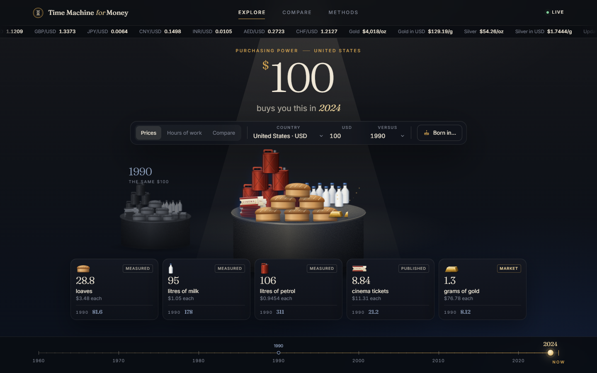
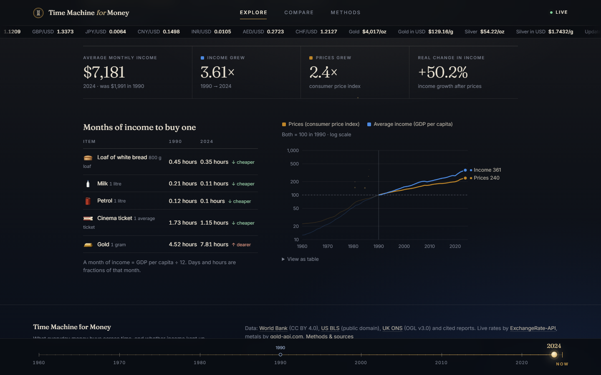
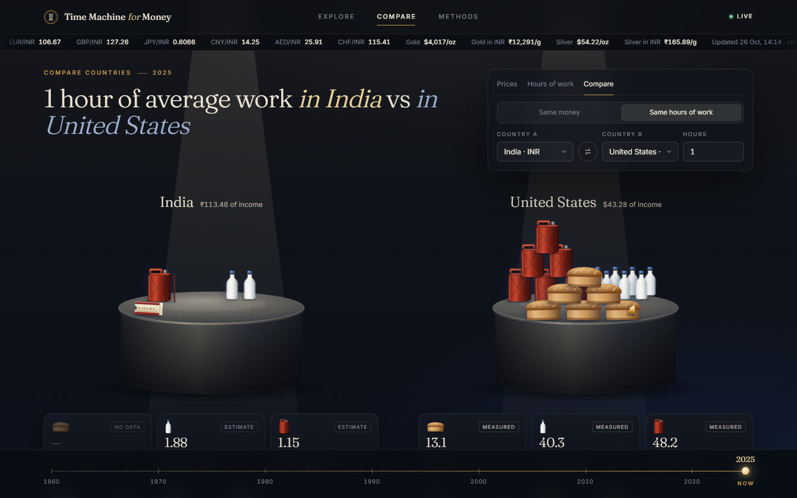
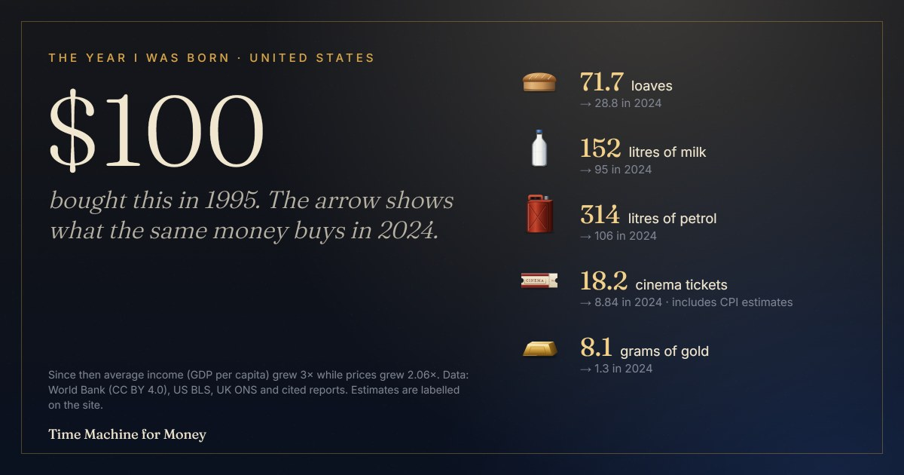
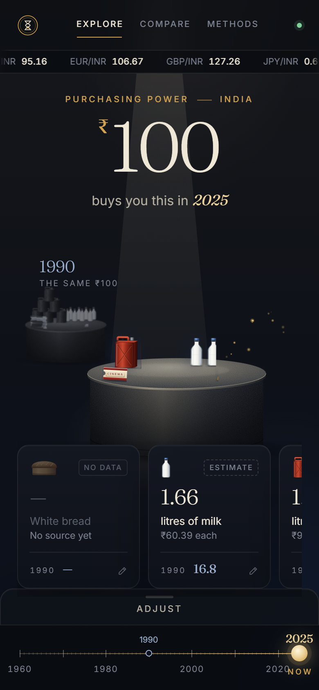

# Time Machine for Money

See what money buys across time, and whether income kept up. Pick an amount and a country, drag the gold timeline, and a pile of everyday things (bread, milk, petrol, a cinema ticket, a gram of gold) grows or dissolves into gold dust on a pedestal, year by year since 1960. Built on open World Bank data, with every estimate labelled.

React (Vite, plain JSX) · Framer Motion · Canvas 2D particles · d3-scale · one Python data script · works offline.



| Did income keep up? | Compare countries |
|---|---|
|  |  |

| Share card (birth-year mode) | Phone |
|---|---|
|  |  |

**What you can do**
- Scrub 1960 → now for 31 countries and watch the pile change; compare against any year on the ghost pedestal.
- **Hours of work**: see what one hour of average work buys instead of a fixed amount.
- **Compare countries**: two pedestals on one timeline, by the same money (converted at that year's exchange rate) or the same hours of work.
- **Did income keep up?**: average income vs prices, months of income per item, and a chart that draws as you scrub.
- **Birth-year mode** with a downloadable share image (PNG drawn on a canvas).
- **Your own prices**: type your local price for any item; it is saved only in your browser and clearly labelled.
- **Live strip**: today's exchange rates and gold/silver, cached, with the time they were updated.

## Run it

```bash
npm install
npm run dev        # http://localhost:5173
npm run build      # static site in dist/
```

Refresh the data (Python 3.11, standard library only, no API keys):

```bash
python scripts/build_data.py   # writes public/data.json
```

## Where the numbers come from

| Data | Source | Licence |
|---|---|---|
| Consumer price index, exchange rate, GDP per capita (local currency) | [World Bank WDI](https://data.worldbank.org/) | CC BY 4.0 |
| Petrol pump price, US$/litre (1991–2016) | World Bank WDI Database Archives | CC BY 4.0 |
| Gold, US$/troy oz (1960–2025) | [World Bank Pink Sheet](https://www.worldbank.org/en/research/commodity-markets) | CC BY 4.0 |
| US bread, milk, petrol average prices | [US BLS](https://www.bls.gov/cpi/factsheets/average-prices.htm) | Public domain |
| UK bread (800 g loaf) and milk (pint) average prices | [UK ONS](https://www.ons.gov.uk/) series CZOH, CZNT | OGL v3.0 |
| Single reference prices (Japan bread/milk, cinema tickets, India milk) | Cited in `scripts/build_data.py` and on the Methods page | Cited figures |
| Live exchange rates (browser only) | [ExchangeRate-API open access](https://www.exchangerate-api.com) | Free with attribution |
| Live gold and silver spot (browser only) | [gold-api.com](https://gold-api.com) | Free, no key |

Each price on screen is labelled as **measured**, a **published figure**, **world gold price × exchange rate**, or **estimated from CPI** (the nearest measured price scaled by the change in the consumer price index). Missing years say "no data". The Methods page in the app lists every formula, caveat and source.

## Optional item photos

Drop transparent PNGs named `bread.png`, `milk.png`, `fuel.png`, `ticket.png`, `coin.png`, `note.png` into `public/items/` and the app uses them. Without them it draws its own SVG objects.

## Limitations

- "Average income" is GDP per capita, a proxy for output per person. It is not wages or take-home pay.
- Bread, milk and cinema prices exist only for India, the US, the UK, Japan and Brazil (and not bread in India/Brazil or milk in Brazil). The other 26 countries have gold and petrol only, and show "no data" for the rest until you enter your own price.
- "Hours of work" assumes 2,080 working hours a year (40 × 52) for every country.
- Many years are CPI estimates anchored to one published price, which assumes the item moved with overall inflation.
- Japan's bread and milk are Tokyo prices; India's milk is a single day's all-India average.
- Currency changes (Brazil 1994, Mexico 1993, Poland 1995, Türkiye 2005, the euro in 1999) mean early amounts are converted units nobody held; the site flags these years. Pre-1999 euro-area exchange rates are converted from the old currencies at the fixed euro rates.
- The World Bank stopped publishing petrol prices after 2016, and the US CPI series currently ends at 2024.
- Live rates depend on two free third-party services; if they are down the strip shows the last saved values and the rest of the site is unaffected.

## Licence

Code: MIT. Data belongs to its publishers under the licences above; World Bank data is credited under CC BY 4.0.
